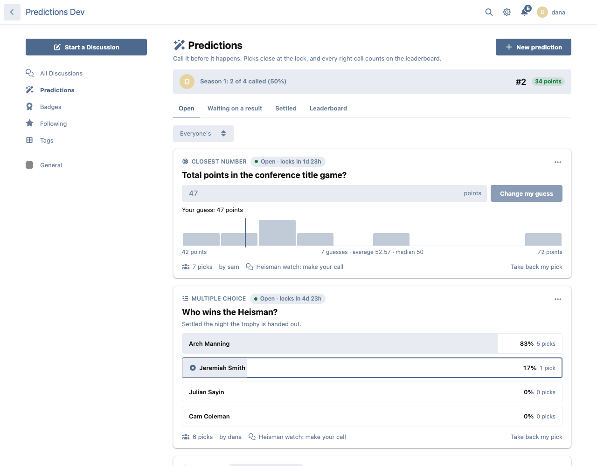
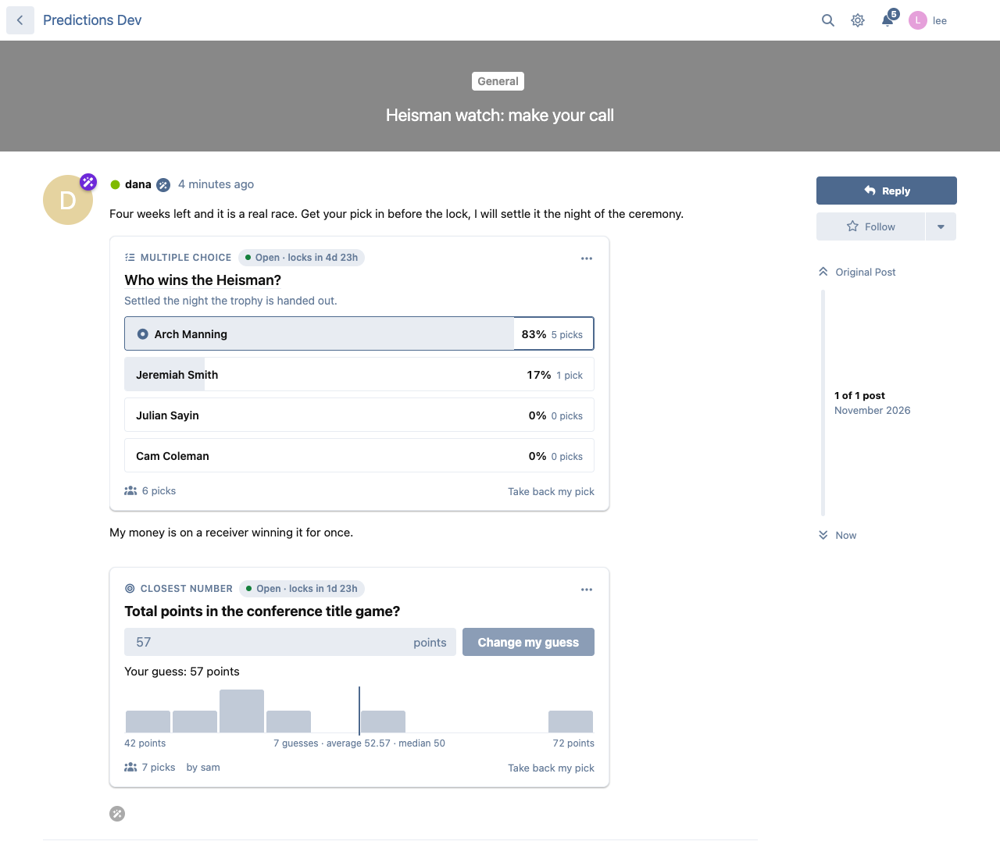
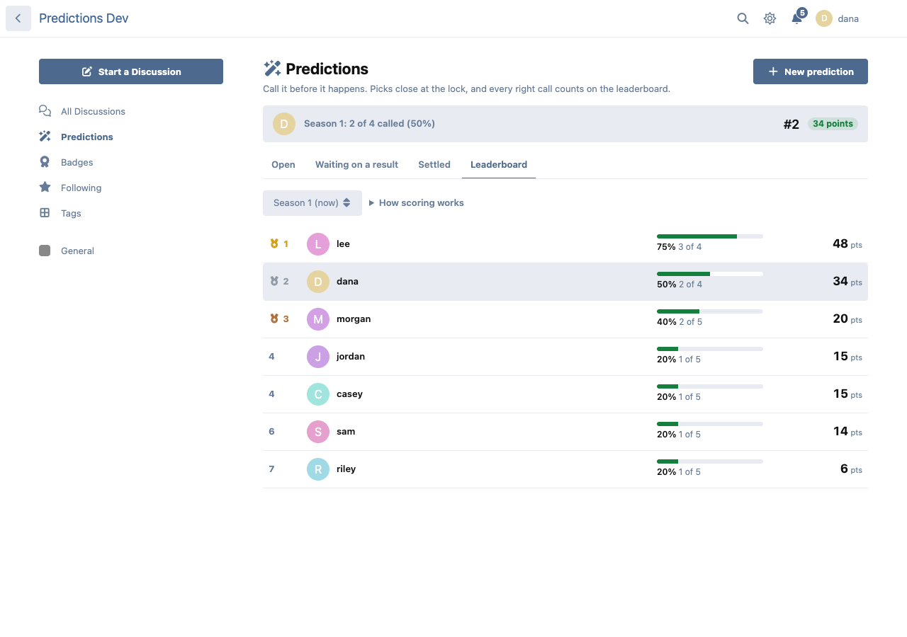
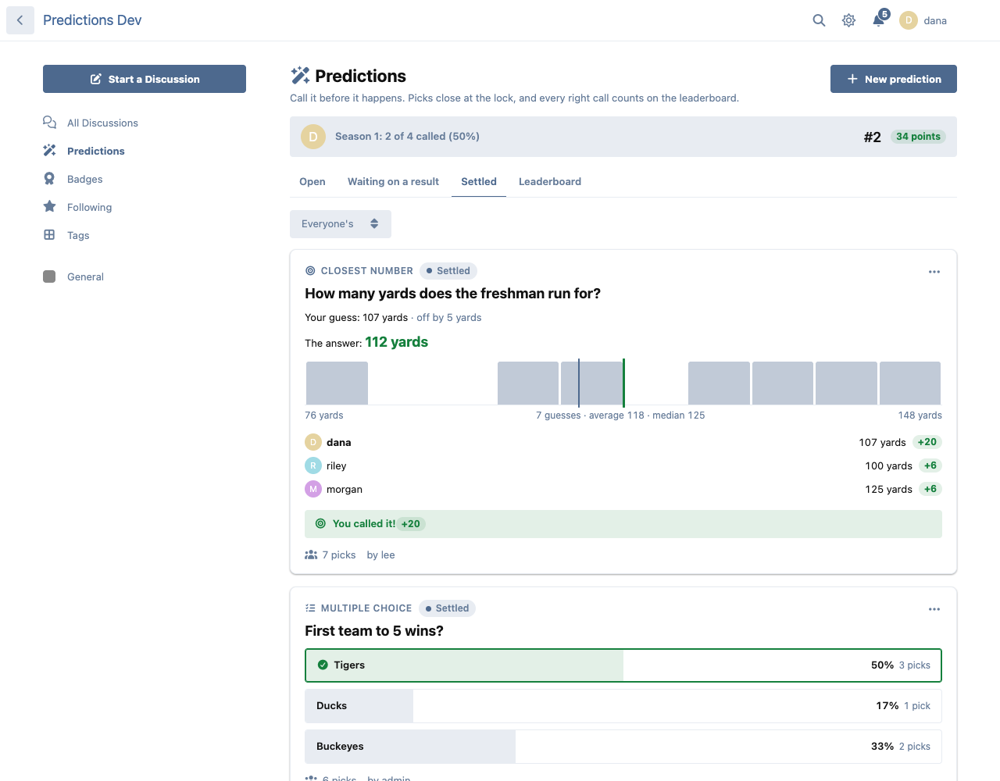
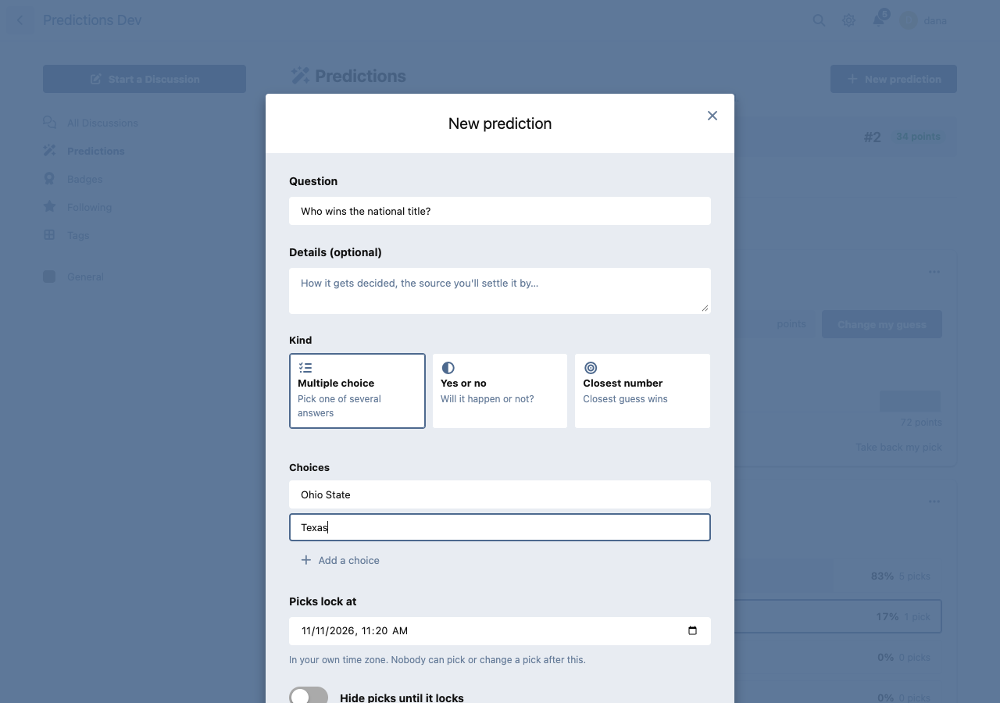
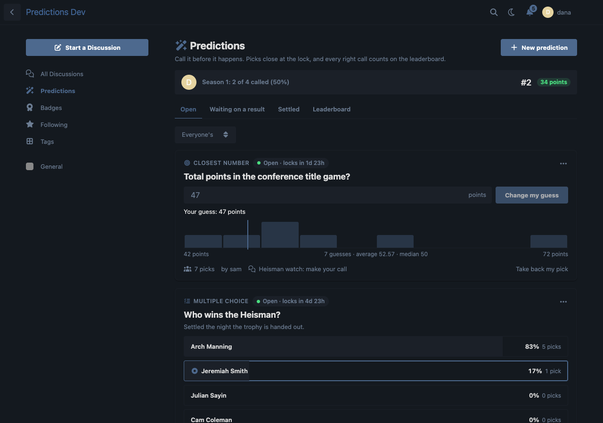

# Predictions

Members call it before it happens. A Flarum 2 extension for predictions about anything: the Heisman, Best Picture, whether Flarum 2.1 ships by December 15.



## What members get

- **Three kinds of prediction.** Multiple choice (2 to 12 choices), yes or no, and **closest number**, where the nearest guess wins.
- **A lock time.** Pick, change your pick or take it back until the lock; then picks close. The countdown is on every card.
- **Hidden picks, if the creator wants.** Nobody sees how others picked, or the totals, until it locks. No following the crowd.
- **Settling.** The creator says what happened (settling early also locks picks). A moderator can correct it, and everyone's points follow, or call it off: nobody gets points. Results in a season that has ended don't change.
- **"You called it!"** Everyone who picked gets a notification with how they did.
- **Bold calls pay more.** A right call is worth 10 points, plus up to 10 more the fewer people saw it coming (an admin can switch the bonus off). For a number, the closest guess scores 20; with a "within ±" range set, every other guess that close scores 5 to 10.
- **Fair play.** A prediction counts toward the leaderboard once 3 people besides whoever settles it have picked, and whoever settles it never scores from it. Once others have picked, only a moderator can change the question, hide the picks or push the lock later.
- **A /predictions page** with Open, Waiting on a result, Settled and Leaderboard tabs, filters for the ones you picked or made, and your season so far: "Season 1: 7 of 10 called (70%) · 🔥 3 in a row · #4".
- **A season leaderboard** ranked by points, with hit rates, records and streaks, past seasons and all-time.
- **Oracles.** When an admin ends a season, its top predictors (3 by default) become Oracles: a badge through FoF Badges, if it's installed, and/or a group of your choice. The group moves to each new season's Oracles; the badge is kept for good.
- **In discussions and posts.** Add a prediction to your own discussion from its menu, and it shows under the first post. Or paste a prediction's link on a line of its own in any post, in any editor, and it shows as the card. The composer has a **Prediction** button that makes one and drops the link in.
- **A record on profiles:** "18 of 25 called (72%) · Oracle ×2".
- **A page per prediction** with who picked what, once picks are out in the open.









Built on default Flarum's own page structure and CSS variables, so it follows light, dark and themes, and works on phones.



## Installation

```sh
composer require ernestdefoe/predictions
```

Then enable it in the admin panel. The scheduler should be running (`php flarum schedule:run` every minute), as for any Flarum forum: it stamps locks and tells creators it's time to settle.

### Updating

```sh
composer update ernestdefoe/predictions
php flarum migrate
php flarum cache:clear
```

## Permissions

| Permission | Default |
|---|---|
| View predictions | Everyone, guests included |
| Pick on predictions | Members |
| Open predictions | Members |
| Settle, edit and delete any prediction | Moderators |

The creator can edit their prediction while it's open, settle it once, and delete it while nobody else has picked, as long as they may still open predictions (a suspended member can't).

## How it stays right

- **Race-safe picks.** Every pick is judged against the lock time inside a database transaction that locks the prediction's row, so a pick at 7:59:59.999 against an 8:00 lock, or one that lands alongside a settle, is judged against the row as it is at that moment. One pick per member is also a unique key.
- **Queued, idempotent scoring.** Settling writes the answer under the same lock and queues the scoring. The job runs only while the prediction is unscored, under the row lock, and rescoring rebuilds every pick and every affected season total from scratch. The scheduler catches anything a queue lost. Running any step twice changes nothing.
- **A lean leaderboard.** Season totals live in their own table, rebuilt for exactly the members a prediction touched. The board is the same handful of queries for 5 rows or 100.
- **Nothing extra on other pages.** The forum bundle only wires things up (about 5 KB gzipped); the card, the pages and the forms are one chunk loaded when first needed. Discussion lists cost no queries; a discussion page costs one.

## Links

- [Packagist](https://packagist.org/packages/ernestdefoe/predictions)
- [GitHub](https://github.com/ernestdefoe/predictions)

☕ If you like the things I build, consider [buying me a coffee](https://buymeacoffee.com/ernestdefoe).
